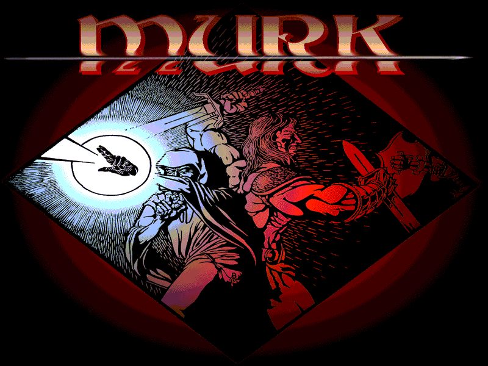
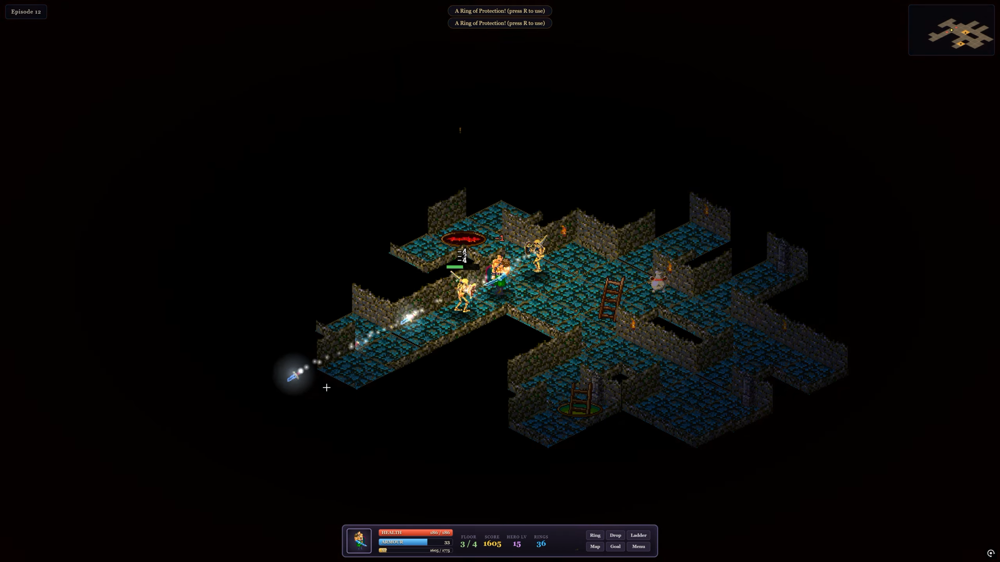

# Murk — Isometric Dungeon Crawler

<p align="center">
  
</p>

<p align="center">
  <b>A classic 1999 isometric dungeon crawler, reimagined for the modern web with Three.js and WebGL.</b>
</p>

<p align="center">
  <a href="https://moonwho101.github.io/MurkThreejs/">
    
  </a>
</p>

<p align="center">
  <a href="https://moonwho101.github.io/MurkThreejs/"><b>👉 https://moonwho101.github.io/MurkThreejs/ 👈</b></a><br>
  <i>No installation, no downloads, no plugins — runs instantly in any modern web browser!</i>
</p>

---

## Overview

**Murk** is a fast-paced, arcade-style isometric dungeon crawler running directly in your web browser. Built on **Three.js** and WebGL, this project is a ground-up modernization of the original 1998–1999 Windows game created by Mark Longo (originally built with Win32, MFC, DirectDraw, and DirectSound).

This modern release preserves the charming late-90s pixel art, original sound effects, and multi-floor episode layouts, while completely overhauling the experience with smooth real-time movement, smart pathing, dynamic WebGL lighting shaders, Roguelite talent choices, and full gamepad support.

Whether you are looking to relive late-90s PC gaming nostalgia or jump into an immediate browser-based dungeon delve, your adventure begins with a single click.

---

## 🎮 Play Immediately in Your Browser

The game is hosted on **GitHub Pages** and configured to run out of the box:

### 🔗 **[Play Murk Now](https://moonwho101.github.io/MurkThreejs/)**

- **Instant access:** Loads in seconds on Chrome, Firefox, Safari, Edge, and mobile browsers.
- **Zero build or setup required:** Pure static web architecture with zero external runtime dependencies.
- **Save & Continue:** Automatically tracks your progress, best runs, and settings in your browser's local storage.

<p align="center">
  
  <br>
  <i>In-game combat with dynamic torchlight, projectile effects, minimap, and HUD.</i>
</p>

---

## ✨ Modern Features & Enhancements

- 🗡️ **4 Distinct Champions:** Play as the **Warrior**, **Cleric**, **Thief**, or **Wizard**, each with tailored combat stats, projectile types, firing rhythms, and armor capabilities.
- 💡 **WebGL Torchlight & Ambient Shaders:** Custom GLSL shaders render dynamic flickering torchlight that illuminates dungeon corridors, cast radial ambient glow, and trigger screen hit flashes and particle bursts.
- 🧭 **Intelligent Navigation & Pathing:** Fluid screen-space WASD / arrow movement that automatically glides around corridor corners and winding walls, supplemented by click-to-walk pathfinding and click-to-attack targeting.
- 🎯 **Tactical Diagonal Combat:** Smart 4-diagonal auto-aim assist locks onto nearby threats when firing forward, complemented by right-click directional shooting.
- ⚠️ **Monster Attack Wind-ups:** Enemies flash bright gold just before loosing projectiles, rewarding observant players with reaction-based sidestepping and dodging.
- 🌟 **Level-Up Talent Drafting:** Earn XP by defeating monsters and choose 1 of 3 randomized perks upon leveling up (increase missile volleys, raise damage ceilings, fire faster, boost movement speed, gain piercing shots, or leach life).
- 🗺️ **Comprehensive Map Systems:** A real-time HUD minimap tracks your position in large dungeons, plus a full explored-floor map overlay (`M` or `Tab`) with ladder indicators, lair locations, and floor switching.
- 🏆 **The Blue Treasure Hunt & Rival Factions:** Red treasure is no more — both the player (Team 1) and a competing Rival squad (Team 2) vie for the single sacred Blue Treasure.
- ⚔️ **Dynamic Rival Squad AI:** Rivals awaken immediately at game start. The first rival searches the dungeon depths for the blue treasure and carries it back to their lair, while their teammates hover as an escort squad hunting monsters and hostile players.
- 🏰 **Infiltrate Rival Lairs:** Rivals bring the treasure back to their lair (marked with the blue circle pad) to fortify and guard it. Invade their lair, defeat the defenders, reclaim the treasure, and bring it home!
- 🛡️ **Rings of Protection & Resurrection:** Deploy temporary invulnerability shields to escape tight spots. If you fall, you resurrect back at your home pad with dungeon state intact!
- 🎮 **Full Gamepad Support:** Native plug-and-play controller support using the HTML5 Gamepad API.
- ⚙️ **In-Game Settings Menu:** Fine-tune SFX and atmospheric dungeon audio sliders, toggle aim assist, screen shake, fullscreen, control hints, and auto-climbing stairs on the fly (`Esc`).

---

## 🛡️ Choose Your Champion

| Champion | Archetype | Health | Damage | Projectile | Playstyle |
| :--- | :--- | :---: | :---: | :--- | :--- |
| **Warrior** | Fighter | High (40) | 2 – 3 | Throwing Blades / Axes | Armoured frontline bruiser with heavy survivability. |
| **Cleric** | Battle Priest | Medium (36) | 1 – 3 | Frost Bolts | Carries extra Rings of Protection and reads sacred scrolls. |
| **Thief** | Rogue | Medium (34) | 1 – 3 | Rapid Daggers | Highest movement speed and fastest firing rate. |
| **Wizard** | Sorcerer | Low (30) | 2 – 4 | Explosive Fireballs | Glass cannon with devastating high-impact ranged magic. |

---

## 🕹️ Controls

Murk supports keyboard, mouse, and gamepads:

### Keyboard & Mouse

| Action | Control | Notes |
| :--- | :--- | :--- |
| **Move** | `W` `A` `S` `D` / Arrow keys / Numpad | Follows tunnel corners automatically |
| **Walk to Tile** | `Left Click` (or hold to follow cursor) | Pathfinds toward mouse position |
| **Attack / Focus** | `Left Click` on an enemy | Closes into diagonal firing line and shoots |
| **Fire (Auto-Aim)** | `Space` / `J` / `Ctrl` | Fires with aim assist along 4 diagonals |
| **Fire Toward Cursor** | `Right Click` | Shoots directly toward mouse position |
| **Zoom In / Out** | `Mouse Wheel` (or `+` / `-`) | Adjust camera view distance |
| **Use Ladder / Stairs** | `E` / `Enter` / Double-click stairs | Travel between dungeon floors |
| **Ring of Protection** | `R` | Activates invulnerability shield |
| **Drop Relic** | `Q` | Places the carried relic down |
| **Dungeon Map** | `M` / `Tab` | Opens full explored-floor map |
| **Pause / Settings** | `Esc` | Audio volume, toggles, controls |
| **Objective / Goal** | `F2` | Read current mission briefing |
| **Help Screen** | `H` / `F1` | Quick reference for all keybinds |
| **Fullscreen / Mute** | `F` / `N` | Toggle fullscreen or mute sound |

### Gamepad Controls

- **Left Stick / D-Pad:** 8-direction character movement
- **Right Trigger (RT) / Right Stick:** Fire with auto-aim
- **A Button:** Use stairs / ladder
- **X Button:** Activate Ring of Protection
- **Y Button:** Drop relic
- **Back / Select:** View floor map
- **Start:** Pause menu

---

## 📜 Rules of the Dungeon

1. **Race for the Blue Treasure:** Red treasure is no longer placed in the dungeon. Both your team (Team 1) and the rival squad (Team 2) compete to locate the single sacred Blue Treasure hidden in the dungeon depths.
2. **Beware of Rivals (Team 2):** When rivals are present, they awaken immediately upon entering the dungeon. An in-game alert warns you of their presence.
3. **Rival Expedition Tactics:** The first player from Team 2 searches through the levels for the blue treasure and rushes to carry it back to their lair. Other Team 2 players hover around their leader as an armed escort, scouting for monsters and eliminating non-friendly players.
4. **Lair Defense & Infiltration:** Rivals bring the blue treasure back to their lair (marked on the floor and map by the blue circle pad, located columns over from the green player pad). Once secured, they fortify their lair to guard it, while occasionally venturing out to hunt monsters. Infiltrate their lair, slay the guards, and seize the treasure!
5. **Beware the Wake:** Taking the treasure awakens dormant monsters throughout the dungeon! Use your **Ring of Protection** (`R`) and hustle back to your home pad.
6. **Follow the Guide:** A green compass arrow indicator on your screen points directly toward your home pad while carrying the treasure.
7. **Watch for Flashing Foes:** When an enemy flashes gold, it is about to fire — step out of the diagonal line of fire.
8. **Drop & Recover:** Taking damage while carrying the treasure causes the carrier (player or rival) to drop it immediately. Ambush rivals to steal the treasure, or clear threats to recover your own drop.
9. **Level Up:** Defeating monsters and rivals fills your XP bar. Every level grants a choice of 3 randomized perks to build your character for deeper runs.

---

## ⚔️ Factions & Teams

Murk features a three-way dynamic conflict:

| Faction | Team | Role & Behavior |
| :--- | :---: | :--- |
| **Player & Allies** | **Team 1** | You and your friendly allies start at your green home pad on Floor 1. Seek the blue treasure and return it home to conquer the episode. |
| **Rival Adventurers** | **Team 2** | Competing champions based in their deep dungeon lair (blue circle pad). The first rival hunts the treasure, while teammates form an escort squad to fight monsters and enemy players. |
| **Dungeon Inhabitants** | *Neither (Team 0)* | Skeletons, Mouthers, Ogres, Beholders, and Death Orbs. Monsters belong to neither team and are aggressively hostile toward both Team 1 and Team 2. |

---

## 👾 Dungeon Bestiary

- **Skeleton:** Fast-moving undead dungeon scouts equipped with throwing weapons.
- **Gibbering Mouther:** Vile crawling monstrosities that spit acidic projectiles.
- **Brute (Ogre):** Hulking brutes hurling heavy axes and stones with punishing health pools.
- **Beholder:** Floating multi-eyed terrors launching swift, searing energy orbs.
- **Death Orb:** Lethal high-tier bosses with massive health bars and rapid-fire barrages.

---

## 💻 Running Locally

Because Murk is built entirely with client-side vanilla JavaScript and Three.js, you can run and modify it locally without any build pipelines, npm installs, or compilers.

1. **Clone the repository:**
   ```bash
   git clone https://github.com/moonwho101/MurkThreejs.git
   cd MurkThreejs
   ```

2. **Start any local static server:**
   - **Using Python 3:**
     ```bash
     python -m http.server 8000
     ```
   - **Using Node (npx):**
     ```bash
     npx serve
     ```
   - **Using VS Code Live Server:** Right-click `index.html` and click **Open with Live Server**.

3. **Open in your browser:**
   Navigate to `http://localhost:8000` (or the port provided by your server).

---

## 🏗️ Architecture & Technology Stack

- **Three.js (`lib/three.min.js`):** Orthographic camera and 2D-in-3D sprite world rendering with depth sorting and pixel-perfect scaling.
- **Custom GLSL Shaders (`js/renderer.js`):** Real-time fragment shaders powering dynamic torchlight attenuation, ambient color grading, monster hit flashes, and glowing halos.
- **Dungeon Engine (`js/dungeon.js`):** Isometric coordinate transforms, grid collision handling, ladder connections, and multi-floor level loading from `assets/levels.json`.
- **Entity & Combat Logic (`js/entities.js`, `js/game.js`):** Player and monster finite state machines, projectile simulation, damage rolling, armor mitigation, and pathfinding.
- **Controls & Input Buffering (`js/controls.js`):** Responsive screen-space directional mapping, corner-assist smoothing, mouse raycasting, and HTML5 Gamepad polling.
- **Web Audio API (`js/audio.js`):** Dynamic sound synthesis and multi-channel audio playback for footsteps, missile releases, creature cries, and impact effects.
- **Persistent State (`js/ui.js`):** Browser `localStorage` saving for episode unlocks, user preferences, talent builds, and best-time records.

---

## 🏛️ Historical Context & Heritage

The original **Murk** was created in **1998–1999 by Mark Longo** as an arcade quest game during the golden era of Windows 95/98 PC gaming. Developed with Microsoft Visual C++, MFC, DirectDraw, and DirectSound, it showcased fast-paced 2D isometric action and early network multiplayer capabilities.

This Three.js browser edition honors that history by preserving the authentic sprite sheets, creature graphics, sound effects, and level definitions, making this classic accessible to anyone worldwide directly through their web browser.

---

## 📄 License

This project is open-source under the MIT License. Original game assets, sound effects, and level designs are preserved from the 1998–1999 release of Murk by Mark Longo.


